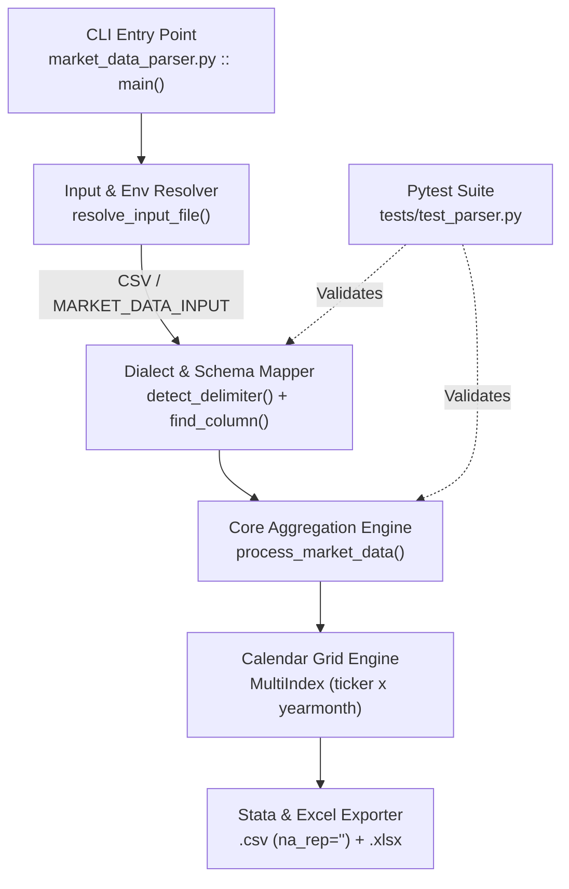

# IDX Monthly Market Data Aggregator

[](https://www.python.org/)
[](https://pandas.pydata.org/)
[](https://numpy.org/)
[](LICENSE)

A quantitative data engineering pipeline that transforms daily Indonesia Stock Exchange (IDX / BEI) equity trades into a monthly firm-period panel dataset (`ticker` $\times$ `yearmonth`), ready for empirical asset pricing and corporate finance workflows in **Stata MP/SE**, Python, and R.

---

## Why This Pipeline Exists

Collapsing daily stock data into a monthly panel often introduces two silent econometric errors:

1. **Zero-Volume Pollution**: Retaining non-trading days (`volume <= 0`) creates artificial zero daily returns, deflating intra-month return volatility (`vol_t`) and distorting Amihud (2002) illiquidity averages.
2. **Suspension Gap Compression**: Applying naive row shifts (`df.groupby('ticker').shift(1)`) directly on collapsed active months links non-adjacent calendar months whenever a stock is temporarily suspended. If a stock trades in February, is suspended throughout March, and resumes in April, a row-level shift computes the April return against February's closing price.

`idx-monthly-market-aggregator` prevents both defects by filtering strictly for active trading days before intra-month aggregation, then projecting the collapsed panel onto a complete rectangular calendar grid (`ticker` $\times$ `all_calendar_months`) prior to computing cross-month lags ($t-1, t-12$) and leads ($t+1$).

---

## Architecture & Pipeline Flow


### Six-Stage Processing Engine

1. **Dialect & Schema Auto-Detection**: Inspects the CSV header to select comma (`,`) or semicolon (`;`) delimiters and maps column aliases case-insensitively (`ticker`/`code`/`symbol`/`kode_emiten`, `date`/`datetime`/`timestamp`/`tgl_transaksi`, `close_price`/`close`/`adj_close`, `volume`/`vol`/`vol_saham`).
2. **Daily Pre-Processing & Active Trade Filter (`FR-01`)**:
   - Standardizes ticker symbols (trims whitespace, converts to uppercase, strips the `.JK` exchange suffix).
   - Drops rows with missing values, non-positive closing prices (`close <= 0`), or zero trading volume (`volume <= 0`).
   - Sorts chronologically by `(ticker, date)` and deduplicates same-day records (`keep='last'`).
3. **Intra-Month Daily Metrics (`FR-02`)**:
   - **Daily Return**: $R_{i,d} = \frac{\text{Close}_{i,d}}{\text{Close}_{i,d-1}} - 1$ within each ticker series.
   - **Daily Trading Value (IDR Millions)**: $\text{TV}_{i,d} = \frac{\text{Close}_{i,d} \times \text{Volume}_{i,d}}{10^6}$.
   - **Daily Amihud Illiquidity**: $\text{ILLIQ}_{i,d} = \frac{|R_{i,d}|}{\text{TV}_{i,d}} \times 10^6$ (evaluated when $\text{TV}_{i,d} > 0$).
4. **Monthly Emiten Aggregation (`FR-03`)**:
   - Collapses daily observations to `(ticker, yearmonth)` using end-of-month closing price (`close_end`), mean closing price (`close_mean`), mean and total trading volume (`volume_mean`, `volume_sum`), active trading day count (`trading_days`), sample standard deviation of daily returns (`vol_t` with `ddof=1`), maximum daily return (`maxret_t`), and mean Amihud illiquidity (`illiq_t`).
5. **Balanced Calendar Grid Projection (`FR-04`)**:
   - Constructs a Cartesian `MultiIndex` spanning every unique ticker across every continuous calendar month from the earliest to the latest period in the raw dataset.
   - Computes 1-month and 12-month lags (`ret_t`, `rev_t`, `mom_t`) and 1-month leads (`ret_t_plus_1`, `illiq_t_plus_1`, `vol_t_plus_1`) along true calendar time.
   - Replaces any $\pm\infty$ values with `NaN` and removes unpopulated grid rows corresponding to suspended months (`trading_days` is null).
6. **Observation Window Filtering & Export (`FR-05`)**:
   - Filters the master panel to the target observation window (defaults to `2021-01` through `2024-12`, while utilizing prior months such as `2020-01..2020-12` as lookback history for 12-month momentum and 2025 months for $t+1$ leads).
   - Exports a Stata-ready CSV (using empty strings for missing values so Stata's `import delimited` assigns numeric system missing `.`) and an optional three-sheet Excel workbook (`OBS_2021_2024`, `FULL_2020_2025`, `SUMMARY_STATS`).

### System Architecture & Module Map



---

## Variable Specifications & Econometric Definitions

The exported CSV and primary Excel sheet contain 17 columns in fixed order:

| # | Column Name | Type | Formula / Aggregation Rule | Econometric Role |
|---|-------------|------|----------------------------|------------------|
| 1 | `ticker` | String | Uppercase IDX issuer code (`.JK` removed) | Panel entity identifier ($i$) |
| 2 | `yearmonth` | String | `YYYY-MM` format | Panel time identifier ($t$) |
| 3 | `close_end` | Float | Last active daily closing price in month $t$ | Month-end price level |
| 4 | `close_mean` | Float | Arithmetic mean of daily closing prices in month $t$ | Average monthly price level |
| 5 | `volume_mean` | Float | Arithmetic mean of daily volume in month $t$ | Average daily trading activity |
| 6 | `volume_sum` | Float | Sum of daily trading volume in month $t$ | Cumulative monthly share turnover |
| 7 | `trading_days` | Integer | Count of active trading days ($\text{Volume} > 0$) in month $t$ | Liquidity and activity screen |
| 8 | `ret_t` | Float | $\frac{\text{Close\_end}_{i,t}}{\text{Close\_end}_{i,t-1}} - 1$ | Contemporaneous monthly return |
| 9 | `vol_t` | Float | $\sqrt{\frac{1}{D_{i,t}-1} \sum_{d=1}^{D_{i,t}} (R_{i,d} - \bar{R}_{i,t})^2}$ | Intra-month daily return volatility (`ddof=1`) |
| 10 | `illiq_t` | Float | $\frac{1}{D_{i,t}} \sum_{d=1}^{D_{i,t}} \left(\frac{|R_{i,d}|}{\text{TV}_{i,d}} \times 10^6\right)$ | Amihud (2002) monthly illiquidity |
| 11 | `maxret_t` | Float | $\max_{d \in t} (R_{i,d})$ | Bali, Cakici, and Whitelaw (2011) MAX lottery demand |
| 12 | `rev_t` | Float | $\text{ret}_{i,t-1}$ | Short-term monthly return reversal |
| 13 | `mom_t` | Float | $\frac{\text{Close\_end}_{i,t-1}}{\text{Close\_end}_{i,t-12}} - 1$ | Jegadeesh and Titman (1993) $12-1$ month momentum |
| 14 | `ln_price_t` | Float | $\ln(\text{Close\_end}_{i,t})$ | Log share price control |
| 15 | `ret_t_plus_1` | Float | $\text{ret}_{i,t+1}$ | 1-month-ahead lead return (dependent variable) |
| 16 | `illiq_t_plus_1` | Float | $\text{illiq}_{i,t+1}$ | 1-month-ahead lead illiquidity (dependent variable) |
| 17 | `vol_t_plus_1` | Float | $\text{vol}_{i,t+1}$ | 1-month-ahead lead volatility (dependent variable) |

---

## Project Structure

```text
idx-monthly-market-aggregator/
├── market_data_parser.py    # Core 6-stage CLI parser and aggregation engine
├── requirements.txt         # Python runtime dependencies (pandas, numpy, openpyxl)
├── LICENSE                  # MIT License
├── .env.example             # Optional environment variable template for default input path
├── .gitignore               # Git exclusion rules for virtual environments and raw datasets
├── README.md                # Architecture, variable specifications, and usage guide
└── tests/
    └── test_parser.py       # Unit tests verifying suspension gaps, deduplication, and edge cases
```

---

## Installation & Setup

### Prerequisites
- Python 3.10+
- `pip` and a virtual environment manager (`venv` or `conda`)

### Install Dependencies

```bash
git clone https://github.com/<your-username>/idx-monthly-market-aggregator.git
cd idx-monthly-market-aggregator

python -m venv .venv
# Windows (PowerShell)
.\.venv\Scripts\Activate.ps1
# macOS / Linux
source .venv/bin/activate

pip install -r requirements.txt
```

---

## Usage

### 1. Input Data Format

Supply a CSV file (comma or semicolon separated) containing daily stock trades. Include one year of lookback prior to your observation start date (e.g., include `2020` daily prices when analyzing `2021-2024` so `mom_t` is populated in `2021-01`) and at least one month after your observation end date (e.g., `2025-01` so `t+1` leads are populated in `2024-12`).

```csv
ticker,date,close_price,volume
BBCA.JK,2020-01-02,6690,41580000
BBCA.JK,2020-01-03,6720,38210000
TLKM.JK,2020-01-02,3910,61200000
```

### 2. Command-Line Execution

Run the pipeline against your daily CSV file:

```bash
python market_data_parser.py --input path/to/Raw_DailyPrices.csv --out-dir ./output
```

For fast iteration when only the Stata CSV is needed (skipping the 3-sheet Excel workbook):

```bash
python market_data_parser.py --input path/to/Raw_DailyPrices.csv --out-dir ./output --skip-excel
```

### 3. CLI Options

| Flag | Default | Description |
|------|---------|-------------|
| `-i`, `--input` | Auto-resolved | Path to raw daily CSV file (or set `MARKET_DATA_INPUT` in environment). |
| `-o`, `--out-dir` | `.` | Primary directory for generated CSV and Excel outputs. |
| `-s`, `--secondary-dir` | `None` | Optional secondary directory to mirror generated outputs. |
| `--skip-excel` | `False` | Skip `.xlsx` generation and export only the Stata CSV file. |
| `--obs-start` | `2021-01` | Start `YYYY-MM` of the primary observation panel (`OBS_2021_2024`). |
| `--obs-end` | `2024-12` | End `YYYY-MM` of the primary observation panel (`OBS_2021_2024`). |

---

## Importing into Stata MP/SE

The generated `parsed_monthly_market_variables_2021_2024.csv` can be loaded directly into Stata and declared as a monthly `xtset` panel:

```stata
* 1. Import monthly market panel
import delimited "parsed_monthly_market_variables_2021_2024.csv", clear varnames(1) encoding("UTF-8")

* 2. Convert YYYY-MM string into Stata monthly date (%tm)
gen int month_id = monthly(yearmonth, "YM")
format month_id %tm

* 3. Encode ticker and declare balanced/unbalanced panel structure
encode ticker, gen(firm_id)
xtset firm_id month_id, monthly

* 4. Verify uniqueness and inspect summary statistics
isid ticker yearmonth
xtdescribe
summarize ret_t vol_t illiq_t maxret_t rev_t mom_t ln_price_t ret_t_plus_1
```

---

## Running Automated Tests

The repository includes unit tests validating delimiter detection, case-insensitive schema mapping, `.JK` suffix removal, single-trading-day volatility handling (`ddof=1`), and calendar grid suspension gap isolation:

```bash
python -m pytest tests/ -v
```
